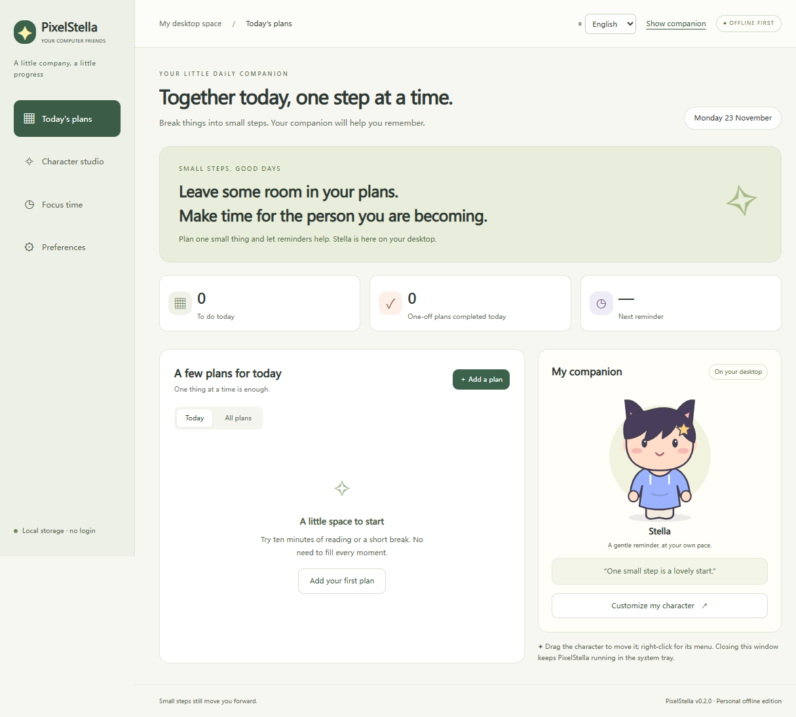
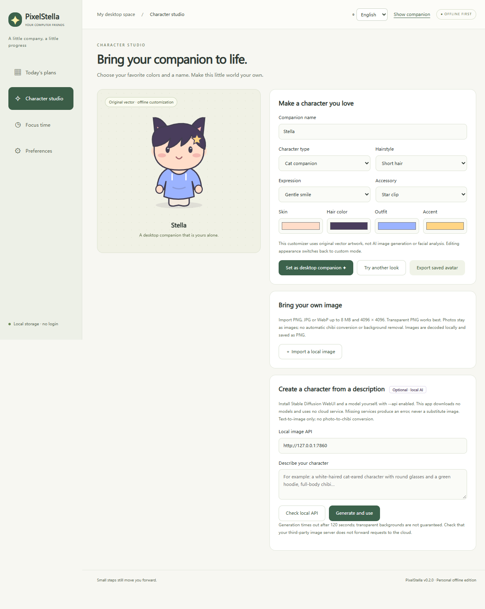

[简体中文](README.md) · [English](README.en.md) · [Français](README.fr.md)

# PixelStella-Companion-YourComputerFriends

A customizable, local-first Windows desktop companion for study plans, gentle reminders and focus time. **v0.2.0 preview**, built with Electron and TypeScript. MIT licensed.





## What works

- Original offline chibi customizer: human, cat, rabbit or fox; hairstyles, expressions, accessories and colors. Export a transparent PNG.
- Import a PNG, JPG or WebP image: up to 8 MB and 4096 × 4096, re-encoded locally to PNG up to 1024 pixels. Photos are displayed as images, without automatic chibi conversion or background removal.
- Draggable floating character, optional always-on-top, size adjustment, context menu and tray restoration.
- Create, edit, complete and delete study plans; one-off, daily or weekday schedules; pause recurring plans; optional notes and categories.
- In-app and companion reminders, five-minute snooze, optional Windows notifications. Catch up missed reminders within 24 hours, only the latest occurrence for recurring plans; persistent deduplication.
- Focus timer: 15, 25 or 45 minutes, pause, resume and reset.
- Chinese, English and French: select a language at the top right. The panel, pet, menus, messages and dates update together. Your names, notes, plans and prompts are never translated. Native Windows buttons follow the OS language.
- Optional loopback-only AUTOMATIC1111-compatible text-to-image API. No model downloads or fabricated fallback images.

## Run on Windows

With a complete portable build, double-click `PixelStella.exe`. Keep the whole folder together. Python, Node.js and a browser are not required for that build. This is an unsigned Windows x64 development preview, not a Setup installer. No GitHub Release has been published by this work.

From source, use Windows, Node.js 24+ and pnpm 11:

```powershell
pnpm install --frozen-lockfile
node node_modules/electron/install.js
pnpm build
pnpm start
```

After building, `start-windows.bat` also launches the project-local Electron runtime without changing PowerShell policies. Closing the main window leaves the application in the tray. Use **Quit PixelStella** to stop it. Reminders require the application to remain running; they cannot fire instantly while it is fully quit, asleep or powered off.

```powershell
pnpm typecheck
pnpm test
pnpm test:e2e
pnpm test:i18n
pnpm audit
pnpm package:portable
```

Build before testing. Portable output: `release/PixelStella-v0.2.0-win-x64/`. Packaging refuses to overwrite an existing release folder. [Development guide](docs/DEVELOPMENT.en.md) · [Verification](docs/VERIFICATION.en.md).

## Optional local AI

Install Stable Diffusion WebUI and an appropriately licensed model yourself, and enable `--api`. Enter a loopback HTTP address such as `http://127.0.0.1:7860` in Character studio. Check the model list, then request generation. The adapter uses `/sdapi/v1/sd-models` and `/sdapi/v1/txt2img`, with 6-second connection-test and 120-second generation timeouts.

Only your character prompt and fixed generation parameters are sent to the local service. Study plans, reminders and imported photos are not sent. Check whether third-party extensions forward requests elsewhere. Real model inference, GPU compatibility and output quality have **not** been validated here; tests use synthetic HTTP fixtures. Photo-to-chibi conversion is not implemented. Transparency is not guaranteed.

## Data and privacy

Saves live in `%APPDATA%\PixelStella`: `state.json` stores appearance, plans, preferences, timer and up to 500 reminder receipts; `assets/` contains normalized images. No account, telemetry or cloud sync. Saves are **not encrypted**. See [Privacy](PRIVACY.en.md).

On first launch, if no new save exists, the application copies the old `%APPDATA%\Xingban\state.json` and its referenced image. It preserves the old files and existing new saves. Invalid legacy saves stop migration instead of silently resetting data; back up and repair before retrying.

Deleting a plan does not remove reminder history or exports. Changing a character does not remove old image files. Windows Notification Center may retain plan titles; enable Quiet mode for more privacy.

## Boundaries and contribution

No Setup installer, signing, auto-update, auto-start, Live2D, autonomous walking, voice interaction or reading of other applications' notifications. Windows notification delivery depends on system settings and needs manual verification. Another clean Windows device has not been validated. Screenshots use synthetic data only.

See [contributing](CONTRIBUTING.md), [security](SECURITY.md), [license](LICENSE-PixelStella.txt), [third-party notices](THIRD_PARTY_NOTICES.md) and [publishing preparation](PUBLISHING.md). Original code and vector artwork are MIT, copyright 2026 prodigylinda. Imported images and third-party models retain their own licenses. Source exports exclude dependencies, EXEs, private saves, photographs and model weights.
