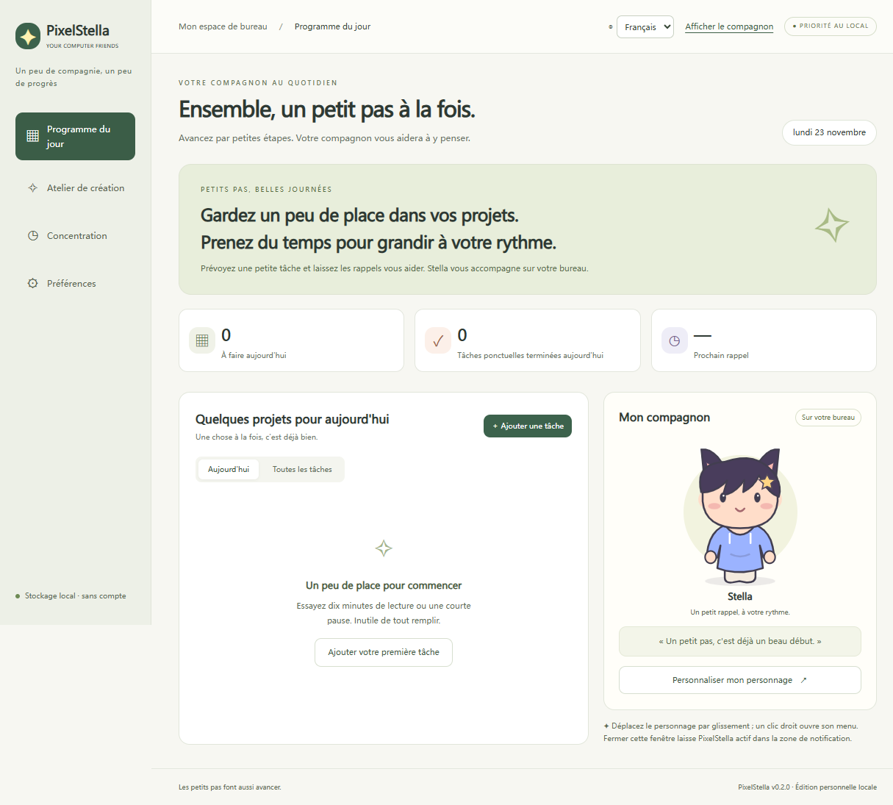
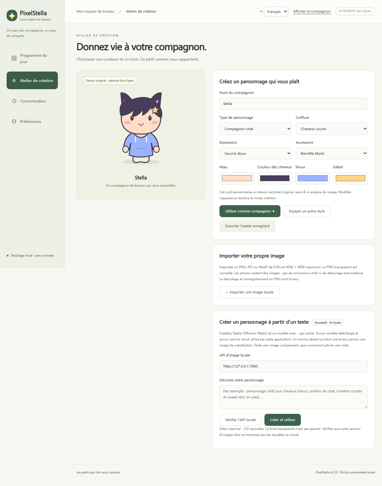

[简体中文](README.md) · [English](README.en.md) · [Français](README.fr.md)

# PixelStella-Companion-YourComputerFriends

Un compagnon de bureau Windows personnalisable pour les tâches d'étude, les rappels et la concentration. Données locales, **aperçu v0.2.0**, Electron et TypeScript, licence MIT.





## Fonctionnalités

- Création chibi hors ligne à partir de dessins vectoriels originaux : humain, chat, lapin ou renard ; coiffures, expressions, accessoires et couleurs. Exportation PNG transparente.
- Importation PNG, JPG ou WebP, jusqu'à 8 Mo et 4096 × 4096 ; réencodage local en PNG de 1024 pixels maximum. Les photos restent des images : pas de conversion chibi ni de détourage automatique.
- Personnage flottant déplaçable, premier plan facultatif, taille réglable, menu contextuel et restauration depuis la zone de notification.
- Création, modification, suppression et validation de tâches ; rappels ponctuels, quotidiens ou en semaine ; suspension des tâches récurrentes, notes et catégories facultatives.
- Rappels dans l'application et sur le compagnon, report de cinq minutes et notifications Windows facultatives. Reprise des rappels manqués sur 24 heures, dernière occurrence seulement pour les tâches récurrentes ; dédoublonnage persistant.
- Minuteur de 15, 25 ou 45 minutes, pause, reprise et réinitialisation.
- Chinois, anglais et français via le sélecteur en haut à droite. Interface, compagnon, menus, messages et dates changent ensemble. Noms, notes, tâches et descriptions restent dans leur langue d'origine. Les boutons natifs Windows suivent la langue du système.
- API locale facultative compatible AUTOMATIC1111, texte vers image. Aucun téléchargement de modèle ni image de substitution présentée comme résultat généré.

## Utilisation sous Windows

Dans le dossier portable complet, ouvrez `PixelStella.exe`. Conservez tous les fichiers ensemble. Ce programme embarque son environnement et ne nécessite ni Python, ni Node.js, ni navigateur préinstallé. Il s'agit d'un aperçu de développement Windows x64 non signé, sans installateur Setup. Aucun GitHub Release n'a été publié par ce travail.

Depuis les sources : Windows, Node.js 24+ et pnpm 11.

```powershell
pnpm install --frozen-lockfile
node node_modules/electron/install.js
pnpm build
pnpm start
```

Après compilation, `start-windows.bat` lance également Electron local sans modifier les stratégies PowerShell. Fermer la fenêtre laisse l'application dans la zone de notification. **Quitter PixelStella** arrête les rappels. Aucun rappel instantané lorsque l'application est quittée, l'ordinateur éteint ou en veille.

```powershell
pnpm typecheck
pnpm test
pnpm test:e2e
pnpm test:i18n
pnpm audit
pnpm package:portable
```

Compilez avant les tests. Sortie portable : `release/PixelStella-v0.2.0-win-x64/`. Un dossier de version existant n'est jamais écrasé. [Guide technique](docs/DEVELOPMENT.fr.md) · [Vérification](docs/VERIFICATION.fr.md).

## IA locale facultative

Installez Stable Diffusion WebUI et un modèle dont la licence convient à votre usage ; activez `--api`. Dans l'atelier, configurez une adresse HTTP de boucle locale, par exemple `http://127.0.0.1:7860`. Vérifiez la liste des modèles puis lancez une création. L'adaptateur utilise `/sdapi/v1/sd-models` et `/sdapi/v1/txt2img` : délai de 6 secondes pour la connexion et 120 secondes pour la création.

Seuls la description du personnage et des paramètres fixes sont envoyés au service local. Aucune tâche, aucun historique ni photo importée n'est envoyé. Vérifiez les éventuels transferts des extensions tierces. L'inférence réelle, la compatibilité GPU et la qualité des résultats **n'ont pas été validées** ici ; les tests utilisent un serveur HTTP synthétique. La conversion photo vers chibi n'est pas implémentée. Le fond transparent n'est pas garanti.

## Données et confidentialité

Les fichiers sont dans `%APPDATA%\PixelStella` : `state.json` conserve l'apparence, les tâches, les préférences, le minuteur et jusqu'à 500 entrées d'historique ; `assets/` contient les images normalisées. Sans compte, télémétrie ni synchronisation cloud. Les fichiers ne sont **pas chiffrés**. Voir [Confidentialité](PRIVACY.fr.md).

Au premier lancement, si aucune nouvelle sauvegarde n'existe, l'application copie `%APPDATA%\Xingban\state.json` et l'image référencée. Les anciens fichiers sont conservés et aucune sauvegarde existante n'est écrasée. Une sauvegarde ancienne invalide bloque la migration : sauvegardez et réparez-la avant de réessayer.

Supprimer une tâche n'efface ni l'historique ni les exports. Changer de personnage ne supprime pas les anciennes images. Le Centre de notifications Windows peut conserver des titres de tâches ; le mode silencieux offre plus de discrétion.

## Limites et contribution

Sans installateur Setup, signature, mise à jour automatique, démarrage automatique, Live2D, déplacement autonome, voix ou lecture des notifications d'autres applications. L'affichage des notifications Windows dépend du système et reste à vérifier manuellement. Aucun autre ordinateur Windows vierge n'a été validé. Les captures utilisent uniquement des données synthétiques.

Voir [contribution](CONTRIBUTING.md), [sécurité](SECURITY.md), [licence](LICENSE-PixelStella.txt), [mentions tierces](THIRD_PARTY_NOTICES.md) et [préparation GitHub](PUBLISHING.md). Code et dessins originaux sous MIT, copyright 2026 prodigylinda. Images importées et modèles tiers gardent leurs licences. Les exports de sources excluent dépendances, EXE, sauvegardes privées, photos et poids de modèles.
