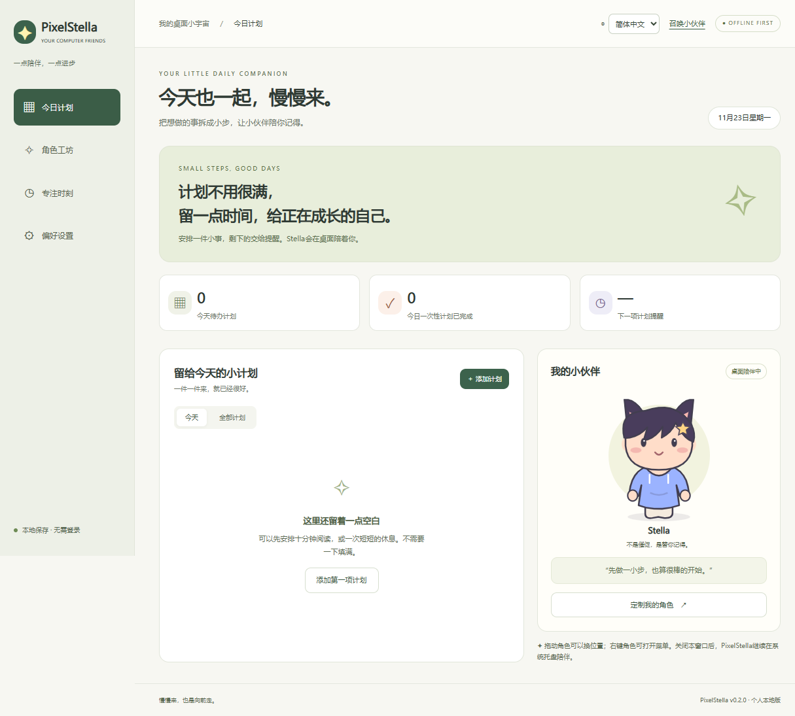
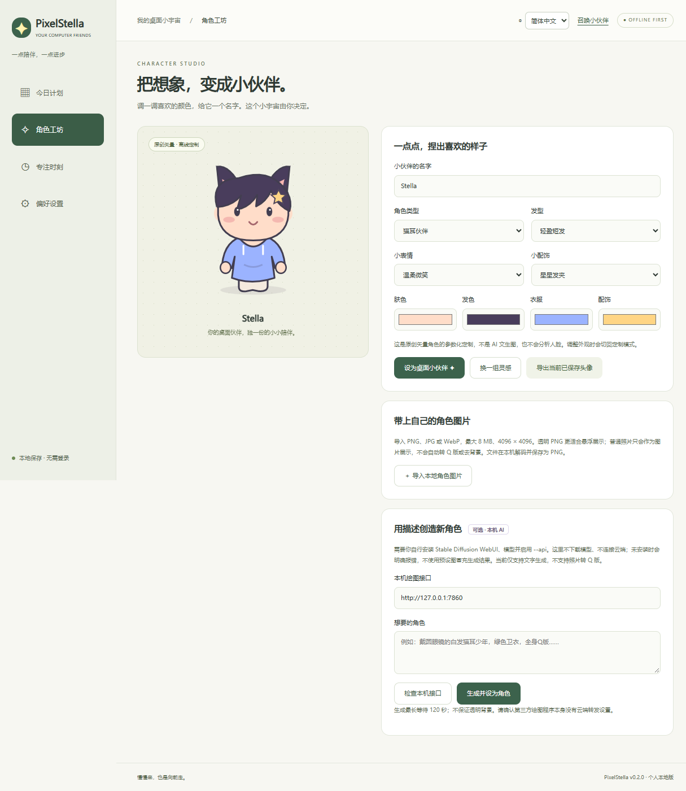

[简体中文](README.md) · [English](README.en.md) · [Français](README.fr.md)

# PixelStella-Companion-YourComputerFriends

**给桌面添一个小伙伴，也替你记住今天的小计划。**

PixelStella是一款 Windows 本地桌宠与学习提醒工具：定制自己的 Q 版角色，或导入喜欢的图片，让它留在桌面，陪你安排学习、接收提醒和完成一段专注。

A local-first Windows desktop companion with customizable chibi avatars, study reminders and focus timers.

`Windows` · `Electron` · `TypeScript` · `Local-first` · `MIT` · `v0.2.0 Preview`

[开始使用](#开始使用) · [开发指南](docs/DEVELOPMENT.md) · [测试记录](docs/VERIFICATION.md) · [隐私说明](PRIVACY.md) · [更新记录](CHANGELOG.md)

## 界面预览

### 今日计划



### 角色工坊



截图来自实际运行的应用，使用空白存档或合成测试数据，不含私人照片与真实学习计划。

## 当前功能

| 模块 | 已实现能力 |
|---|---|
| 离线 Q 版定制 | 人形、猫耳、兔耳、狐狸；发型、表情、配饰与配色，实时预览及透明 PNG 导出 |
| 图片角色 | 导入 PNG/JPG/WebP，规范化为本地 PNG；透明图片适合悬浮展示 |
| 悬浮桌宠 | 拖动、置顶、显示与收起、大小调整、右键菜单、托盘恢复 |
| 学习计划 | 新增、编辑、删除、完成一次性计划；每天或工作日重复、暂停与恢复 |
| 提醒 | 桌宠气泡、应用内消息、五分钟稍后提醒；尝试发起 Windows 系统通知 |
| 补发与去重 | 补发最近24小时错过的提醒，重复计划只补发最近一次，持久记录触发状态 |
| 专注计时 | 15 / 25 / 45 分钟，暂停、继续、重置与结束提醒 |
| 本地数据 | 无需登录，本机存储、计划 JSON 导出；关闭主窗口后继续在托盘运行 |

离线角色是原创 SVG 的参数化定制，**不是 AI 文生图**。导入普通照片只会作为图片展示，不会自动转 Q 版或抠图。图片上限8 MB、4096 × 4096，保存时规范化为不超过1024像素的 PNG。离线定制角色可导出透明 PNG；导入或生成的图片保留其原有背景。

## 开始使用

### Windows 便携版

拿到完整便携文件夹后，双击 `PixelStella.exe`。不需要预装 Python、Node.js 或浏览器，**请保留整个文件夹，不要只复制 EXE**。

当前已在本地构建并验证 Windows x64 便携开发预览版，尚未发布 GitHub Release。下载源码不会自动获得运行环境；可以按下面的步骤自行构建。

1. 在“角色工坊”定制或导入角色，设为桌面小伙伴。
2. 在“今日计划”安排任务、学科、提醒时间和备注。
3. 拖动桌宠换位置，右键或点击星星按钮打开面板。
4. 关闭主窗口后继续在托盘运行；选择“退出PixelStella”才会停止。

### 从源码运行

环境要求：Windows、Node.js 24或更新版本、pnpm 11。克隆或下载源码后，在项目根目录执行：

```powershell
pnpm install --frozen-lockfile
node node_modules/electron/install.js
pnpm build
pnpm start
```

Electron 运行时采用显式下载步骤，不自动批准其他依赖构建脚本。依赖和构建完成后也可双击 `start-windows.bat`；不修改 PowerShell 执行策略。

```powershell
pnpm typecheck
pnpm test
pnpm test:e2e
pnpm audit
pnpm package:portable
```

测试前先运行 `pnpm build`。便携版输出到 `release/PixelStella-v0.2.0-win-x64/`；已有同名产物时脚本会停止，避免覆盖。环境排查见 [开发指南](docs/DEVELOPMENT.md)。

## 可选本机 AI

已实现 AUTOMATIC1111 Stable Diffusion WebUI 兼容适配器，可读取 `/sdapi/v1/sd-models` 并调用 `/sdapi/v1/txt2img`。需要使用者自行安装模型、启用 `--api` 并检查许可，项目不自动下载大型模型。

默认地址为 `http://127.0.0.1:7860`，只接受回环 HTTP 地址，不接收任意远程服务地址或云端密钥。

| 能力 | 状态 |
|---|---|
| 接口配置、连接检查、文字生成请求、图片验证和错误处理 | 已实现，合成 HTTP 测试通过 |
| 真实模型推理、生成质量、显卡适配和耗时 | 未验收，开发环境未安装模型 |
| 照片参考生成、本人照片一键转 Q 版 | 尚未实现 |
| 模型生成透明背景 | 不保证，取决于模型与工作流 |

失败会明确提示，不用预设角色冒充模型生成。第三方绘图软件是否完全离线，仍需检查其扩展与转发配置。详见 [本机 AI 接入](docs/DEVELOPMENT.md#接入真实本机绘图模型)。

## 本地数据与隐私

数据保存在 `%APPDATA%\PixelStella`，与程序文件分开：

- `state.json`：角色参数、计划、设置、计时和最多500条提醒记录。
- `assets/`：导入或生成后重新编码的角色图片。

默认没有账号、云同步或遥测。可选本机绘图只发送角色描述和固定绘图参数，不发送学习计划、提醒历史或导入照片。

存档未加密，共用 Windows 账号时请留意私人内容。删除计划不自动清除提醒历史或导出副本；切换角色不自动删除旧图片。详见 [PRIVACY.md](PRIVACY.md)。

## 验证情况

以下是本地实际运行结果，不是尚未运行的 GitHub Actions 状态：

| 检查 | 结果 |
|---|---|
| TypeScript 严格模式构建 | 通过 |
| 核心测试 | 19项通过 |
| 真实桌面流程 | 10组通过，并在便携版完整重跑通过 |
| 三语言与布局 | 每种运行方式24次语言/页面/宽度检查通过；另有4个原有状态检查通过 |
| 语言保存、用户原文与迁移 | 中英法切换、重启恢复、原文保留及迁移保护通过 |
| 依赖审计 | 本轮未重新联网审计，依赖版本未变 |

测试仅使用独立存档、合成计划和测试图片。完整范围见 [验证报告](docs/VERIFICATION.md)。

## 当前边界

- 提醒需要程序保持运行；退出、关机、睡眠和时间调整会影响时机。补发不是系统后台服务。
- Windows 通知横幅和通知中心送达需目标设备人工验收，“已发起系统通知”不等于送达。
- 当前是未签名的便携开发预览版，没有 Setup 安装器、自动更新或开机自启。
- 尚无 Live2D 骨骼、自动游走、语音交互或其他软件通知读取。
- 未在另一台没有开发环境的干净 Windows 电脑上验收，不宣称支持其他系统。

## 项目结构

```text
src/main/       Electron主进程、存储、受限IPC、本机AI适配器
src/shared/     数据模型、校验、提醒调度、原创角色SVG
src/renderer/   计划面板、角色工坊、专注计时、设置和桌宠
scripts/        构建与便携版打包
tests/          单元、桌面流程与交付启动测试
docs/           开发文档、验证报告与展示截图
assets/         原创程序图标
```

运行环境、构建产物、私人图片、真实计划和模型权重不在源码发布包内。

## 参与项目

欢迎用合成数据反馈可复现问题、提出功能建议或改进体验。请阅读 [贡献说明](CONTRIBUTING.md)；安全问题参见 [SECURITY.md](SECURITY.md)，不要公开上传私人存档。

## 许可证

项目原创代码与原创矢量角色采用 [MIT License](LICENSE-PixelStella.txt)。版权署名为 `prodigylinda`。Electron、Chromium及其他依赖，第三方模型与用户导入图片仍适用各自的许可，详见 [第三方说明](THIRD_PARTY_NOTICES.md)。

## 语言与旧版数据

右上角选择简体中文、English 或 Français，立即同步主窗口、桌宠、托盘和提示，并保存在本机。系统原生对话框中的系统按钮遵循 Windows 语言。角色名、计划、备注和 AI 描述保持原文。

新版数据位于 `%APPDATA%\PixelStella`。首次启动且新版存档不存在时，复制旧 `%APPDATA%\Xingban` 的 state.json 和引用的角色图片。旧文件不删除，不覆盖新版存档；异常存档会阻止迁移并提示启动失败，请先备份后修复。

### 项目发起人及维护者：ZHANG ZHELIN（GitHub：@prodigylinda）。本项目使用 AI 辅助开发。本人承担的产品设计、功能决策、开发与测试工作按实际参与情况说明。
#### 官方仓库：https://github.com/prodigylinda/PixelStella-Companion-YourComputerFriends
